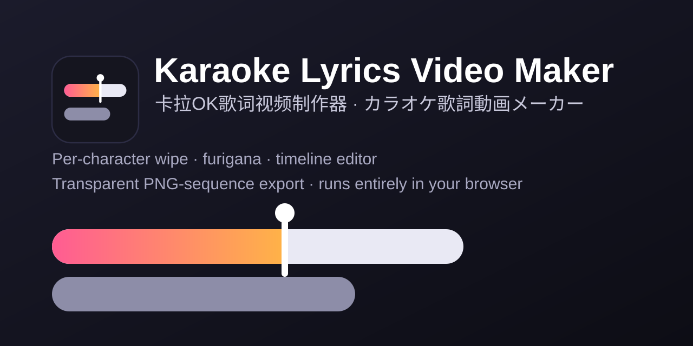

# カラオケ歌詞スタジオ

[English](README.md) · [简体中文](README.zh-CN.md) · **日本語**

ブラウザだけで動くカラオケ歌詞のエディタ兼レンダラーです。一文字ずつのワイプ、漢字の上に揃えたふりがな、
複数行の交互レイアウト、カウントイン、タイムライン編集に対応し、プレビュー上のワイプカーソルをドラッグして目で見ながらタイミングを合わせられます。
Premiere Pro などにそのまま読み込める**透明 PNG 連番**の書き出しも、画面収録もできます。

インストールもビルドも不要です。Chrome / Edge で `index.html` を開くか、フォルダごと静的サーバーに置くだけで使えます。



**オンラインで試す：** `https://<your-github-username>.github.io/karaoke-studio/`
（これはプレースホルダーです。ご自身の GitHub Pages の URL に置き換えてください。手順は[GitHub Pages への公開](#github-pages-への公開)を参照）

## 機能

- 一文字ずつのワイプ。長い音は次の文字までなめらかに流れます
- ふりがなは `漢字{かんじ}` と書くだけで、対応する漢字の真上に中央揃えで表示
- ふりがな付きの文字は、かなの拍（モーラ）単位でタイミング指定が可能
- 複数行レイアウト：行位を交互に使い、ハモリ行は同時に歌わせられます
- 自動で段落分け、各段落の前に 3 つ点のカウントイン
- タイムライン編集：行ごとの移動、一文字ごとの時刻調整、行の出現・消失タイミングの設定
- プレビュー上のワイプカーソル：一時停止して、歌い手が今歌っている位置までドラッグするだけでタイミング合わせ
- 再生しながら `T` キーでタイミングを打つ
- 元に戻す / やり直し（150 ステップ）、プロジェクトファイル（`.kara.json`）、念のためのブラウザ自動保存
- SRT、または一文字ごとにアライメントされた JSON の読み込み（[強制アライメント](#強制アライメントオプション)を参照）
- 書き出し：透明 PNG 連番、現在フレームの PNG、UI を隠した「画面収録モード」
- 表示言語の切り替え（中文 / 日本語 / English）
- 組み込みサンプル 2 件（ふりがな付きの日本語、フランス語）

## クイックスタート

1. **アプリを開く**：Chrome または Edge で `index.html` を開きます（公開したページでも可）。
2. **音声・動画を読み込む**：上部のボタン、またはウィンドウへのドラッグ＆ドロップ。歌詞の時刻はこのメディアの再生時間が基準になります。
3. **歌詞を読み込む**：SRT（行ごとの時間のみ。文字は時間で等分され、あとから調整します）、または `tools/align` が出力する一文字ごとの JSON。「サンプル…」にすぐ使える 2 件があります。
4. **タイミングとレイアウトの調整**（下の「操作リファレンス」を参照）。
5. **保存**：`Ctrl+S` で `.kara.json` プロジェクトファイルに保存します（歌詞・タイミング・スタイルが入ります）。ブラウザにも自動保存がありますが、あくまで保険です。
6. **書き出し**：右側の「書き出し」タブで PNG 連番、または画面収録モードを選びます。

## 操作リファレンス

表示言語は 中文 / 日本語 / English から切り替えられます。以下の名称は日本語表示のものです。

### マウス操作

| 場所 | 操作 | 動作 |
| --- | --- | --- |
| プレビュー | 歌詞をクリック | その行を選択 |
| プレビュー | **ワイプカーソル**（縦線と丸）をドラッグ（モード「校時」） | ある瞬間で一時停止し、カーソルを今歌われている文字へドラッグ → その文字の開始時刻が現在時刻になります |
| プレビュー | ワイプカーソルをドラッグ（モード「ブラウズ」） | この行に沿って再生位置を前後に動かします |
| タイムライン | ブロックの濃い部分をドラッグ | 行全体を移動。上下に別のトラックへドラッグすると行位が変わります |
| タイムライン | 選択ブロック下半分の小さな縦線をドラッグ | 一文字の開始時刻を調整（再生ヘッド付近でスナップ） |
| タイムライン | 濃いブロックの右端をドラッグ | 行の終了時刻を調整 |
| タイムライン | 薄いウィンドウの左端 / 右端をドラッグ | その行がいつ現れ、いつ消えるか（手動設定するとオレンジ色に。ダブルクリックで自動に戻る） |
| タイムライン | ブロック / 空白を右クリック | 段落分け、カウントイン、行位、ハモリ行、分割、結合、行の削除 / 追加 |
| タイムライン | ホイール / Ctrl+ホイール / ルーラーをクリック | スクロール / ズーム / シーク |

### キーボードショートカット

| キー | 動作 |
| --- | --- |
| `Space` | 再生 / 一時停止 |
| `←` `→` | 1 秒移動（Shift：5 秒） |
| `,` `.` | 1 フレーム移動 |
| `↑` `↓` | 前の行 / 次の行を選択 |
| `T` | タイミング打ち。再生中に押すたび、選択行の次の文字の開始時刻を記録します（ふりがな付きの文字は 1 拍ずつ）。最後にもう一度押すと行の終了時刻になり、次の行へ移ります |
| `[` `]` | 行全体を -20ms / +20ms ずらす（Shift：100ms） |
| `P` | ここで段落を分ける |
| `D` | その行のカウントインの表示切り替え |
| `H` | ハモリ行として複製 |
| `S` | 再生ヘッド位置で分割 |
| `M` | 次の行と結合 |
| `1`-`4` / `0` | 行位 1-4 / 自動 |
| `Delete` | 行を削除 |
| `Ctrl+Z` / `Ctrl+Y` | 元に戻す / やり直し |
| `Ctrl+S` / `Ctrl+Shift+S` / `Ctrl+O` | 保存 / 名前を付けて保存 / 開く |

## 表示のルール

- **段落**：直前の歌詞との間隔が「自動分段間隔」以上になると自動で段落が分かれます。「ここで段落を分ける」で手動指定もできます。段落内の各行は行位を順番に使い、行位が空いてから次の行が現れます。
  **段落どうしは先出ししません**。前の段落の最後の行を歌い終えるまで次の段落の歌詞は出ず、次の段落は改めてカウントインから始まります。
- **カウントイン**：各段落の最初の行の前に 3 つの点でカウントダウンします。行ごとに強制表示 / 非表示にもできます。
- **ハモリ・同時に歌う行**：「ハモリ行として複製」で空いている行位（たとえば 3 行目）にコピーが置かれ、各行がそれぞれのタイミングで同時にワイプされます。行位・配置・出現 / 消失時刻は行ごとに手動で上書きできます。
- **ふりがな**：歌詞テキストに `漢字{かんじ}` と書きます。テキストを編集しても、前後で変わらない文字は元のタイミングが保たれます。
- **かな単位のタイミング**：ふりがな付きの文字は、読みの拍（小さいかなは直前の拍に含める）に細分されます。カーソル、タイムライン上の目盛り（黄色の短い線）、タイミング打ち、右側の表のいずれからでも一拍ずつ調整でき、触っていない拍は文字内で等分されます。
- **ワイプの速さ**：各文字は自分の開始から次の文字の開始まで（最後の文字は行の終了まで）ワイプされるので、長い音はゆっくり流れます。長い音の途中で止めたいときは、次の文字か行の終了を実際の位置までドラッグしてください。

## 書き出し

**PNG 連番（透明）**：右側の「書き出し」タブでフレームレート（24 / 25 / 30 / 50 / 60）、開始・終了秒、背景（透明または単色）を選び、「PNG 連番をフォルダに書き出し…」で空のフォルダを指定します。ファイルはプロジェクトの解像度で `lyrics_000001.png`、`lyrics_000002.png`……と書き出されます。「現在のフレームを保存」で 1 枚だけの PNG も保存できます。フォルダへの書き出しには Chromium 系ブラウザが必要です（[対応ブラウザ](#対応ブラウザ)を参照）。

**Premiere Pro**：ファイル → 読み込みで最初の画像を選び、**「イメージシーケンス」**にチェックを入れます。0 秒から書き出した場合は、タイムラインの 0 秒に置けば音声と揃います。

**アルファ付きの ProRes 4444 ファイル 1 本にまとめる**（`-framerate` は書き出し時のフレームレートに合わせてください）：

```bash
ffmpeg -framerate 60 -i lyrics_%06d.png -c:v prores_ks -profile:v 4444 -pix_fmt yuva444p10le lyrics.mov
```

**画面収録モード**：上部の「画面収録モード」を押すとすべての UI が隠れ、映像だけが表示されます。`Esc` で終了します。背景が透明のときは「スタイル → クロマキー色」で背景を塗り、収録後に編集ソフトでその色を抜いてください。

## 強制アライメント（オプション）

ブラウザでは強制アライメントができないため、`tools/align` に Python スクリプトを用意しています。Demucs で歌声を分離し、torchaudio の MMS_FA で SRT を一文字ずつ歌声に合わせます
（日本語のふりがなは pykakasi、中国語は pypinyin を利用）。出力された JSON は「SRT / JSON を読み込み…」で取り込めます。歌声に対するアライメントは精度が高くないので、下書きとして扱ってください。
詳しくは [tools/align/README.md](tools/align/README.md) を参照してください。

## 対応ブラウザ

| ブラウザ | 状況 |
| --- | --- |
| Chrome / Edge（デスクトップ） | 完全対応 |
| その他（Firefox、Safari） | 未検証。**PNG 連番のフォルダ書き出し**には File System Access API、**ローカルフォントの一覧取得**には Local Font Access API が必要で、どちらも現時点では Chromium 系ブラウザのみが対応しています。フォント API が使えなくても、「フォント(CSS)」欄にフォント名を直接入力するか、フォントファイルを読み込めば利用できます |

## プライバシー

すべてブラウザ内でローカルに動作します。音声・動画、歌詞、プロジェクトがどこかへアップロードされることはありません。バックエンドはなく、アプリ自身がネットワーク通信を行うこともありません。
自動保存はブラウザの `localStorage` に保存されます（サイトデータを消去すると失われます）。作業を残すには `.kara.json` ファイルを保存してください。

## 既知の制限

- 音声・動画と読み込んだフォントファイルはプロジェクトに含まれないため、開き直したら再度読み込む必要があります。
- フォルダへの書き出しとローカルフォントの取得には Chrome / Edge が必要です。
- 400MB を超えるメディアでは波形を生成しません（同期には影響しません）。
- 強制アライメントはブラウザ内ではできません。オプションの Python ツールが必要で、歌声に対する結果は粗めです。

## GitHub Pages への公開

このアプリは静的ファイルだけなので、ビルドは不要です。

1. リポジトリを GitHub にプッシュします。
2. **Settings → Pages** を開きます。
3. *Build and deployment* の **Source** を *Deploy from a branch* にし、デフォルトブランチと **/ (root)** フォルダを選んで保存します。
4. 1 分ほどで `https://<GitHub ユーザー名>.github.io/<リポジトリ名>/` で公開されます。

リポジトリ直下の空ファイル `.nojekyll` により、GitHub Pages はすべてのファイルをそのまま配信します。

## スモークテストの実行

```bash
bash tests/run.sh
```

ヘッドレス Chrome でアプリを開き、ワイプカーソルのドラッグなどを自動操作して JSON を出力します。出力に `error` フィールドがなければ合格です。
スクリプトは Windows の標準的な場所にある Chrome を探します。他の環境では、環境変数 `CHROME` に Chrome / Chromium の実行ファイルを指定してください。

## サードパーティ / コンテンツについて

- `samples/` に同梱のサンプル歌詞は、作者がファンソングのために用意したデモデータです。いかなる保証も付きません。
- サンプルプロジェクトはフォント名 `SDK_JP_Web-Heavy` を指定していますが、このフォントは**同梱されていません**。インストールされていない場合は、システムのフォントで代替表示されます。

## ライセンス

[MIT](LICENSE) © 2026 Tsang
