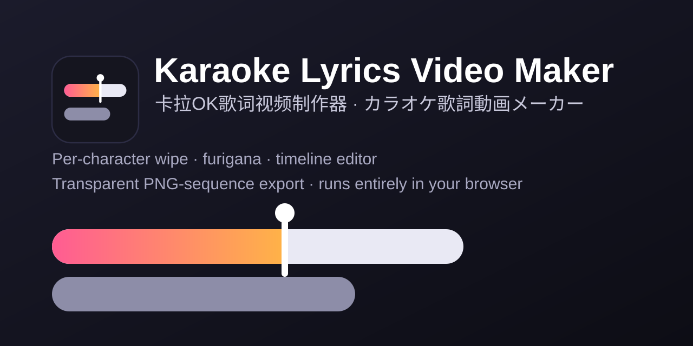

# Karaoke Lyrics Studio

**English** · [简体中文](README.zh-CN.md) · [日本語](README.ja.md)

A pure front-end karaoke lyric editor and renderer. Per-character wipe, furigana aligned above each kanji,
multi-row layouts with count-in dots, a timeline editor, and a draggable wipe cursor for retiming by eye.
Export a **transparent PNG sequence** that Premiere Pro and other editors import directly, or screen-record the preview.

No installation and no build step: open `index.html` in Chrome or Edge, or host the folder on any static server.



**Try it online:** `https://<your-github-username>.github.io/karaoke-studio/`
(this is a placeholder - replace it with the URL of your own GitHub Pages deployment, see [Deploying to GitHub Pages](#deploying-to-github-pages))

## Features

- Per-character wipe, with long notes sliding smoothly to the next character
- Furigana (ruby) written as `漢字{かんじ}`, centred over the kanji it belongs to
- Timing by kana beat (mora) for characters that carry furigana
- Multi-row layout: lines take turns on alternating row slots, plus harmony rows that sing at the same time
- Automatic paragraphs and a three-dot count-in before each paragraph
- Timeline editor: move lines, retime single characters, set when a line appears and disappears
- Draggable wipe cursor in the preview: pause, then drag it to where the singer actually is
- Tap-to-time with `T` while the media plays
- Undo / redo (150 steps), project files (`.kara.json`), and a browser autosave as a safety net
- Import SRT, or a per-character aligned JSON (see [forced alignment](#optional-forced-alignment))
- Export: transparent PNG sequence, single frame PNG, or a clean "screen recording" view
- Interface language switcher (中文 / 日本語 / English)
- Two sample projects built in (Japanese with furigana, French)

## Quick start

1. **Open the app.** Open `index.html` in Chrome or Edge (or visit your hosted copy).
2. **Load the audio or video** (top bar, or drag the file into the window). Lyric times follow its playback time.
3. **Import lyrics.** Either an SRT file (each line's characters are spread evenly over the cue; you retime afterwards) or an aligned JSON from `tools/align`. The *Samples* menu has two ready-made projects.
4. **Retime and lay out** (see the editing reference below).
5. **Save** with `Ctrl+S` to a `.kara.json` project file (lyrics, timing and style are stored in it). The browser also keeps an autosave, but only as a safety net.
6. **Export** from the *Export* tab on the right: PNG sequence, or screen-recording mode.

## Editing reference

The interface can be switched between 中文, 日本語 and English; the names below follow the English interface.

### Mouse

| Where | Action | Effect |
| --- | --- | --- |
| Preview | Click lyrics | Select that line |
| Preview | Drag the **wipe cursor** (vertical bar with a dot), tool set to *Retime* | Pause at a moment, drag the cursor to the character being sung right now: that character's start time becomes the current time |
| Preview | Drag the wipe cursor, tool set to *Browse* | Moves the playback position forward and backward along this line |
| Timeline | Drag the solid part of a block | Move the whole line; drag it up or down to another track to change its row slot |
| Timeline | Drag the small vertical tick in the lower half of the selected block | Adjust one character's start time (snaps near the playhead) |
| Timeline | Drag the right edge of the solid block | Adjust the line's end time |
| Timeline | Drag the left / right thin edge of the pale window | When the line appears / disappears (turns orange when set manually; double-click to go back to automatic) |
| Timeline | Right-click a block or empty space | Paragraph break, count-in dots, row slot, harmony row, split, merge, delete / add line |
| Timeline | Wheel / Ctrl+wheel / click the ruler | Scroll / zoom / seek |

### Keyboard

| Key | Action |
| --- | --- |
| `Space` | Play / pause |
| `←` `→` | Seek 1 s (`Shift`: 5 s) |
| `,` `.` | Step one frame |
| `↑` `↓` | Select previous / next line |
| `T` | Tap-to-time. While playing, each press sets the start time of the selected line's next character (kana beat by beat for characters with furigana); the final press ends the line and moves to the next one |
| `[` `]` | Shift the whole line by -20 ms / +20 ms (`Shift`: 100 ms) |
| `P` | Start a new paragraph here |
| `D` | Toggle count-in dots for the line |
| `H` | Duplicate as a harmony row |
| `S` | Split the line at the playhead |
| `M` | Merge with the next line |
| `1`-`4` / `0` | Row slot 1-4 / automatic |
| `Delete` | Delete the line |
| `Ctrl+Z` / `Ctrl+Y` | Undo / redo |
| `Ctrl+S` / `Ctrl+Shift+S` / `Ctrl+O` | Save / Save as / Open |

## Display rules

- **Paragraphs.** A gap of at least the *auto-paragraph gap* since the previous lyric starts a new paragraph; you can also force a break with "start paragraph here". Within a paragraph, lines take turns on the row slots, and the next line appears once its slot is free. **Paragraphs never pre-show each other**: the next paragraph's lyrics do not appear before the last line of the previous one has been sung, and the new paragraph starts with count-in dots.
- **Count-in dots.** Three dots count down before the first line of each paragraph. Each line can be forced on or off.
- **Harmony / simultaneous rows.** "Duplicate as harmony row" places the copy on a free row slot (for example row 3), and every row wipes on its own timing at the same time. Row slot, alignment, and appear / disappear times can all be overridden per line.
- **Furigana.** Write readings in the lyric text as `漢字{かんじ}`. When you edit the text, characters before and after the change keep their timing.
- **Timing by kana beat.** A character with furigana is split into the beats of its reading (small kana join the previous beat). The cursor, the yellow ticks on the timeline, tap-to-time and the table on the right can all adjust each beat; beats you have not touched are spread evenly inside the character.
- **Wipe speed.** Each character is wiped from its own start until the next character starts (the last character until the line's end), so a long note slides across slowly. To make a long note stop and hold, drag the next character or the line end to where it really is.

## Exporting

**PNG sequence (transparent).** *Export* tab → choose frame rate (24 / 25 / 30 / 50 / 60), start and end seconds, and background (transparent or solid colour) → *Export PNG sequence to folder...* and pick an empty folder. Files are written as `lyrics_000001.png`, `lyrics_000002.png`, ... at the project resolution. *Save current frame* writes a single PNG. Folder export needs a Chromium-based browser (see [Browser support](#browser-support)).

**Premiere Pro.** File → Import, select the first image, and tick **Image Sequence**. If you exported from 0 s, place the clip at 0 s on the timeline and it lines up with the audio.

**Single ProRes 4444 file with alpha** (match `-framerate` to the frame rate you exported):

```bash
ffmpeg -framerate 60 -i lyrics_%06d.png -c:v prores_ks -profile:v 4444 -pix_fmt yuva444p10le lyrics.mov
```

**Screen-recording mode.** The *Screen-recording mode* button in the top bar hides every panel and shows only the picture; press `Esc` to leave. With a transparent background, fill it with the key colour (*Style* tab) and remove that colour in your editor.

## Optional: forced alignment

A browser cannot do forced alignment, so `tools/align` provides Python scripts that separate the vocals (Demucs) and align an SRT to the singing per character (torchaudio MMS_FA; Japanese readings via pykakasi, Chinese via pypinyin). The result is a JSON file you import with *Import SRT / JSON...*. Alignment on singing is imprecise, so treat it as a first draft. See [tools/align/README.md](tools/align/README.md).

## Browser support

| Browser | Status |
| --- | --- |
| Chrome / Edge (desktop) | Fully supported |
| Others (Firefox, Safari) | Not tested. **PNG sequence export to a folder** needs the File System Access API and **listing local fonts** needs the Local Font Access API; both are only available in Chromium-based browsers. Without the font API you can still type a font name in the CSS font-family field or load a font file |

## Privacy

Everything runs locally in your browser. Your audio / video, lyrics and projects are never uploaded anywhere, and the app has no backend and makes no network requests of its own. The autosave is kept in your browser's `localStorage` (clearing site data removes it). Save a `.kara.json` file if you want to keep your work.

## Known limitations

- Audio / video and loaded font files are not stored in the project; load them again after reopening.
- Exporting to a folder and listing local fonts require Chrome or Edge.
- Waveforms are not generated for media larger than 400 MB (sync is unaffected).
- Forced alignment is not available in the browser; it needs the optional Python tools and gives rough results on singing.

## Deploying to GitHub Pages

The app is plain static files, so no build is needed.

1. Push this repository to GitHub.
2. Open **Settings → Pages**.
3. Under *Build and deployment*, set **Source** to *Deploy from a branch*, choose your default branch and the **/ (root)** folder, then save.
4. After a minute your site is available at `https://<your-github-username>.github.io/<repository-name>/`.

The empty `.nojekyll` file makes GitHub Pages serve every file as-is.

## Running the smoke test

```bash
bash tests/run.sh
```

It opens the app in headless Chrome, simulates a few interactions such as dragging the wipe cursor, and prints a JSON result; the test passes when the output contains no `error` field. The script looks for Chrome at the default Windows path; set the `CHROME` environment variable to point at another Chrome / Chromium binary (for example on Linux or macOS).

## Third-party / content notice

- The bundled sample lyrics in `samples/` are the author's own demo data for a fan song. They come without a warranty of any kind.
- The sample projects reference a font named `SDK_JP_Web-Heavy`, which is **not** bundled. Without it installed, the text falls back to system fonts.

## License

[MIT](LICENSE) © 2026 Tsang
