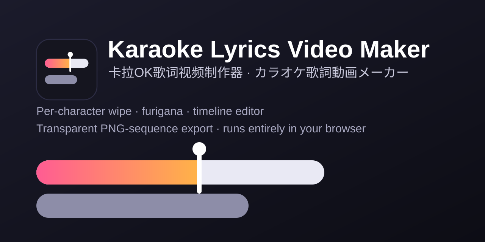

# 卡拉OK歌词工作室

[English](README.md) · **简体中文** · [日本語](README.ja.md)

纯前端的卡拉OK歌词编辑 / 渲染工具：逐字擦除、ふりがな（注音）按字对齐、左右交错多行、预备点、时间线编辑，
还能拖动预览里的擦除光标直接校时。可导出**带透明通道的 PNG 序列**（Premiere 等可直接当图像序列导入），也可以录屏抠像。

无需安装和构建：用 Chrome / Edge 直接打开 `index.html`，或把整个文件夹放到任意静态服务器上。



**在线试用：** `https://<your-github-username>.github.io/karaoke-studio/`
（这只是占位地址，请换成你自己部署后的 GitHub Pages 地址，见[部署到 GitHub Pages](#部署到-github-pages)）

## 功能

- 逐字擦除，长音会平滑地滑向下一个字
- 注音写作 `漢字{かんじ}`，居中显示在对应汉字上方
- 带注音的字可按假名的拍定时
- 多行排版：各行轮流占用行位；和声行可与主旋律同时演唱
- 自动分段，每段开始前有三点预备倒数
- 时间线编辑：整行平移、单字调时、控制每行何时出现 / 消失
- 预览里可拖动的擦除光标：暂停后把光标拖到歌手实际唱到的位置即可校时
- 播放时按 `T` 打点
- 撤销 / 重做（150 步）、工程文件（`.kara.json`）、浏览器自动保存兜底
- 导入 SRT，或逐字对齐的 JSON（见[逐字对齐](#逐字对齐可选)）
- 导出：透明 PNG 序列、单帧 PNG，或纯画面的「录屏模式」
- 界面语言可切换（中文 / 日本語 / English）
- 内置两份示例工程（日语带注音、法语）

## 快速开始

1. **打开应用**：用 Chrome / Edge 打开 `index.html`（或访问你部署好的网址）。
2. **载入音视频**（顶部按钮，或直接把文件拖进窗口）——歌词以它的播放时间为准。
3. **导入歌词**：SRT（只有整句时间，字按时长平均分配，之后再校时），或 `tools/align` 输出的逐字对齐 JSON。「示例…」里有两份现成的。
4. **校时与排版**（见下文「编辑」）。
5. **保存**：`Ctrl+S` 存成 `.kara.json` 工程文件（歌词、时间、样式都在里面）。浏览器里另有一份自动保存，仅作防丢。
6. **导出**：右侧「导出」页 → PNG 序列，或「录屏模式」。

## 编辑

界面可以在中文、日本語、English 之间切换；下面的操作名称以中文界面为准。

### 鼠标

| 位置 | 操作 | 效果 |
| --- | --- | --- |
| 预览 | 点歌词 | 选中该行 |
| 预览 | 拖**擦除光标**（竖线 + 圆点），模式「校时」 | 暂停在某一刻，把光标拖到此刻实际唱到的字 → 该字开始时间 = 当前时间 |
| 预览 | 拖擦除光标，模式「浏览」 | 沿这句歌词前后移动播放时间 |
| 时间线 | 拖块的实色部分 | 整行平移；上下拖到别的轨道 = 改行位 |
| 时间线 | 拖选中块下半部的小竖线 | 调单个字的开始时间（靠近播放头会吸附） |
| 时间线 | 拖实色块右边缘 | 调这一行的结束时间 |
| 时间线 | 拖浅色窗口的左 / 右细边 | 这一行何时出现 / 消失（变橙色 = 手动；双击恢复自动） |
| 时间线 | 右键块 / 空白 | 分段、预备点、行位、和声行、拆分、合并、删除 / 添加行 |
| 时间线 | 滚轮 / Ctrl+滚轮 / 点标尺 | 滚动 / 缩放 / 跳转 |

### 快捷键

| 按键 | 作用 |
| --- | --- |
| `空格` | 播放 / 暂停 |
| `←` `→` | 前后 1 秒（Shift：5 秒） |
| `,` `.` | 逐帧 |
| `↑` `↓` | 选上一行 / 下一行 |
| `T` | 打点：播放时每按一次，给选中行的下一个字打上开始时间（带注音的字按假名一拍一拍打）；最后再按一次 = 行结束并跳到下一行 |
| `[` `]` | 整行 -20ms / +20ms（Shift：100ms） |
| `P` | 在此分段 |
| `D` | 切换这一行的预备点 |
| `H` | 复制为和声行 |
| `S` | 在播放头处拆分 |
| `M` | 与下一行合并 |
| `1`-`4` / `0` | 行位 1-4 / 自动 |
| `Delete` | 删除该行 |
| `Ctrl+Z` / `Ctrl+Y` | 撤销 / 重做 |
| `Ctrl+S` / `Ctrl+Shift+S` / `Ctrl+O` | 保存 / 另存为 / 打开 |

## 显示规则

- **段落**：与前面歌词间隔 ≥「自动分段间隔」自动分段，也可手动「在此分段」。段内各行轮流占用行位，行位空出后下一句才出现；
  **段与段之间不互相预显**——上一段最后一句唱完前不会出现下一段的歌词，下一段另起并带预备点。
- **预备点**：每段第一句前倒数三个点；每行可单独强制显示 / 不显示。
- **和声 / 多行同时唱**：「复制为和声行」会放到空闲行位（如第 3 行），各行按自己的时间同时擦除。行位、对齐、出现 / 消失时间都可逐行手动覆盖。
- **注音**：歌词文本里写 `漢字{かんじ}`；改文本时前后未变的字保留原有时间。
- **按假名定时**：带注音的字按注音的拍（小假名并入前一拍）细分，拖光标、时间线刻度（黄色短线）、打点和右侧表格都能逐拍调；没调过的拍在字内平均分。
- **擦除速度**：每个字从自己的开始一直擦到下一个字开始（最后一个字到行结束），长音会慢慢滑过去；想让长音后停住，就把下一个字或行结束拖到实际位置。

## 导出

**PNG 序列（透明）**：右侧「导出」页 → 选帧率（24 / 25 / 30 / 50 / 60）、起止秒数、背景（透明或纯色）→「导出 PNG 序列到文件夹…」，选一个空文件夹。文件按工程分辨率写成 `lyrics_000001.png`、`lyrics_000002.png`……「保存当前帧」可只存一张 PNG。导出到文件夹需要 Chromium 内核的浏览器（见[浏览器支持](#浏览器支持)）。

**Premiere Pro**：文件 → 导入，选第一张图片并勾选**「图像序列」**。从 0 秒导出时，放在时间线 0 秒处即与音频对齐。

**转成单个带 Alpha 的 ProRes 4444 文件**（`-framerate` 要与导出时的帧率一致）：

```bash
ffmpeg -framerate 60 -i lyrics_%06d.png -c:v prores_ks -profile:v 4444 -pix_fmt yuva444p10le lyrics.mov
```

**录屏模式**：顶部「录屏模式」会隐藏全部界面，只显示画面；按 `Esc` 退出。透明背景时用「样式 → 抠像色」铺底，录完在剪辑软件里抠掉。

## 逐字对齐（可选）

浏览器里做不了强制对齐。`tools/align` 提供一组 Python 脚本：用 Demucs 分离人声，再用 torchaudio MMS_FA 把 SRT 逐字对到歌声上
（日语注音用 pykakasi，中文借助 pypinyin）。输出的 JSON 用「导入 SRT / JSON…」载入即可。对歌声的对齐不够精确，请当作初稿。
详见 [tools/align/README.md](tools/align/README.md)。

## 浏览器支持

| 浏览器 | 状态 |
| --- | --- |
| Chrome / Edge（桌面版） | 完整支持 |
| 其他（Firefox、Safari） | 未测试。**导出 PNG 序列到文件夹**需要 File System Access API，**读取本机字体**需要 Local Font Access API，两者目前只有 Chromium 内核浏览器提供。没有字体 API 时，仍可在「字体族(CSS)」里直接输入字体名，或载入字体文件 |

## 隐私

一切都在你的浏览器本地运行。音视频、歌词和工程文件不会上传到任何地方；应用没有后端，自身也不发起网络请求。
自动保存存放在浏览器的 `localStorage` 中（清除站点数据就没了）。想保留成果请保存 `.kara.json` 文件。

## 已知限制

- 音视频和载入的字体文件不存进工程，重新打开后需再载入一次。
- 导出到文件夹、读取本机字体需要 Chrome / Edge。
- 超过 400MB 的媒体不生成波形（不影响同步）。
- 浏览器内没有强制对齐；需要可选的 Python 工具，且对歌声的结果比较粗糙。

## 部署到 GitHub Pages

应用就是一堆静态文件，不需要构建。

1. 把仓库推送到 GitHub。
2. 打开 **Settings → Pages**。
3. 在 *Build and deployment* 下，把 **Source** 设为 *Deploy from a branch*，选择默认分支和 **/ (root)** 目录，保存。
4. 约一分钟后即可通过 `https://<你的 GitHub 用户名>.github.io/<仓库名>/` 访问。

仓库里的空文件 `.nojekyll` 会让 GitHub Pages 原样提供所有文件。

## 运行冒烟测试

```bash
bash tests/run.sh
```

脚本会用无头 Chrome 打开应用、模拟拖动擦除光标等操作并输出一段 JSON；输出里没有 `error` 字段即通过。
脚本默认在 Windows 的默认路径下找 Chrome，在其他系统上请用环境变量 `CHROME` 指定 Chrome / Chromium 可执行文件。

## 第三方 / 内容声明

- `samples/` 里自带的示例歌词是作者为一首同人歌曲做的演示数据，不附带任何形式的担保。
- 示例工程引用了字体名 `SDK_JP_Web-Heavy`，该字体**并未随仓库提供**；未安装时文字会回退到系统字体。

## 许可证

[MIT](LICENSE) © 2026 Tsang
